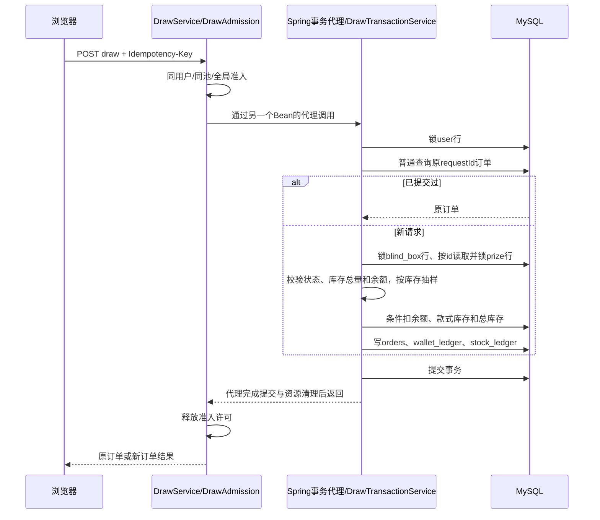

# BlindBox 关键技术文档：抽奖、锁、Redis 与并发

更新：2026-10-27。对照当前 Spring Boot 源码编写；下方源码链接使用仓库相对路径，可在 GitHub 跳转到文件及行号，后续修改实现时需同步维护。

## 1. 先确定当前实现

MySQL 是库存、余额、订单和流水的事实来源。Redis 保存商品元数据缓存与分钟限流计数。抽奖是同步数据库事务，概率根据锁保护下的剩余实体数量计算。

当前没有 Redis 库存预扣、Redis 回补库存、Redis 分布式锁、CAS 版本重试、MQ 异步下单或保底算法。`blind_box.version` 虽然会递增，当前扣减 SQL 没有 `WHERE version = ?`，所以不能把它介绍成版本 CAS 抽奖。

| 关注点 | 实现入口 | 对应验证 |
|---|---|---|
| 库存驱动随机抽样 | [InventoryLottery.draw/select](../blindbox-springboot/src/main/java/com/blindbox/core/InventoryLottery.java#L12) | [InventoryLotteryTest](../blindbox-springboot/src/test/java/com/blindbox/InventoryLotteryTest.java) |
| HTTP 抽奖与结果恢复 | [ApiController.draw/result](../blindbox-springboot/src/main/java/com/blindbox/api/ApiController.java#L39) | [SecurityTest](../blindbox-springboot/src/test/java/com/blindbox/SecurityTest.java) |
| 事务前准入与指标 | [DrawService.draw](../blindbox-springboot/src/main/java/com/blindbox/core/DrawService.java#L29) | [DrawServiceTest](../blindbox-springboot/src/test/java/com/blindbox/DrawServiceTest.java) |
| 扣款、扣库存、订单和流水 | [DrawTransactionService.draw](../blindbox-springboot/src/main/java/com/blindbox/core/DrawTransactionService.java#L17) | [DrawTransactionServiceTest](../blindbox-springboot/src/test/java/com/blindbox/DrawTransactionServiceTest.java) |
| 单实例并发预算 | [DrawAdmission.acquire/Lease.close](../blindbox-springboot/src/main/java/com/blindbox/core/DrawAdmission.java#L32) | [DrawAdmissionTest](../blindbox-springboot/src/test/java/com/blindbox/DrawAdmissionTest.java)、[TransactionBoundaryTest](../blindbox-springboot/src/test/java/com/blindbox/TransactionBoundaryTest.java) |
| 行锁和条件更新 SQL | [PlatformMapper](../blindbox-springboot/src/main/java/com/blindbox/core/PlatformMapper.java#L10) | [MapperBindingTest](../blindbox-springboot/src/test/java/com/blindbox/MapperBindingTest.java) |
| 元数据缓存、实时动态字段与详情快照 | [CatalogService.list/detail](../blindbox-springboot/src/main/java/com/blindbox/core/CatalogService.java#L30) | [CatalogConcurrencyTest](../blindbox-springboot/src/test/java/com/blindbox/CatalogConcurrencyTest.java) |
| 缓存加载、失效与 Redis 熔断 | [CatalogCache](../blindbox-springboot/src/main/java/com/blindbox/core/CatalogCache.java#L21) | [CatalogCacheTest](../blindbox-springboot/src/test/java/com/blindbox/CatalogCacheTest.java) |
| Redis 熔断状态机 | [RedisCircuitBreaker](../blindbox-springboot/src/main/java/com/blindbox/resilience/RedisCircuitBreaker.java) | [RedisCircuitBreakerTest](../blindbox-springboot/src/test/java/com/blindbox/RedisCircuitBreakerTest.java) |
| JWT 前入口保护 | [IngressFilter](../blindbox-springboot/src/main/java/com/blindbox/security/IngressFilter.java#L37) | [SecurityIngressTest](../blindbox-springboot/src/test/java/com/blindbox/SecurityIngressTest.java)、[IngressFilterTest](../blindbox-springboot/src/test/java/com/blindbox/IngressFilterTest.java) |
| 用户额度与 Redis Lua | [RateLimitFilter](../blindbox-springboot/src/main/java/com/blindbox/security/RateLimitFilter.java#L20)、[RedisWindow](../blindbox-springboot/src/main/java/com/blindbox/security/RedisWindow.java#L8) | [RateLimitTest](../blindbox-springboot/src/test/java/com/blindbox/RateLimitTest.java) |

## 2. 抽奖机制：库存就是权重

### 2.1 概率与一个具体例子

设第 i 款奖品剩余库存为 s_i，奖池剩余总量 N = Σs_i：

- 第 i 款概率：P(i) = s_i / N。
- 某稀有度概率：该稀有度所有款式剩余数量之和 / N。
- 抽中后减少对应款式库存与总库存，下次基于新数量抽样。

例如 A 普通款 6 个、B 稀有款 3 个、C 隐藏款 1 个，总量为 10。初始概率为 60%、30%、10%。抽走一个 A 后，变成 5/9、3/9、1/9；如果 C 被抽完，C 的概率就是 0，不会再进入中奖区间。

稀有度是展示和归类字段，不是独立固定权重。同稀有度增加一款奖品，也必须按实际新增数量重新计算占比。

### 2.2 整数票号算法

[InventoryLottery](../blindbox-springboot/src/main/java/com/blindbox/core/InventoryLottery.java#L12) 使用 `SecureRandom.nextLong(N)` 在 `[0, N)` 取得整数票号，再按奖品顺序累计库存。

```text
A: [0, 6)    票号 0..5
B: [6, 9)    票号 6..8
C: [9, 10)   票号 9
```

命中第一个满足 `ticket < cumulative` 的款式。数量为 0 的款式没有区间；总量为 0 返回售罄。负数或缺失库存被拒绝，不依赖浮点概率累计与“最后一款兜底”。时间复杂度 O(k)，k 为款式数；使用 long 累加总量。

[算法测试](../blindbox-springboot/src/test/java/com/blindbox/InventoryLotteryTest.java#L12) 穷举票号、检查零库存、售罄、完整抽空后的精确组成以及概率变化。`SecureRandom` 不等于公开可验证随机，当前没有种子承诺或第三方验奖协议。

### 2.3 展示概率和成交概率

[CatalogService.detail](../blindbox-springboot/src/main/java/com/blindbox/core/CatalogService.java#L74) 返回查询时的概率和 `asOf`。成交时不接受前端提交的概率或中奖款，而是在事务锁保护内重新读取库存并抽样。两次请求之间库存可能变化，因此详情概率不是对未来订单的概率锁定承诺。

## 3. 完整交易、幂等与数据库锁

### 3.1 调用顺序



核心步骤见 [DrawTransactionService.draw](../blindbox-springboot/src/main/java/com/blindbox/core/DrawTransactionService.java#L18)。这里的“已支付”状态由现有同步扣开发余额流程写入，不代表接入了真实第三方支付。

### 3.2 锁分别保护什么

| 顺序 | 锁/操作 | 保护范围 |
|---|---|---|
| 1 | `lockUser`：按用户主键 `SELECT ... FOR UPDATE` | 同一账户余额修改、抽奖/充值等协作写入口，以及该用户的幂等判断 |
| 2 | `findOrderByRequest`：普通 SELECT | 查询已提交订单；依靠前面的用户锁串行化，不对不存在的订单额外加锁 |
| 3 | `lockBox`：按奖池主键 `FOR UPDATE` | 同奖池抽奖、补货、上下架等遵循父锁的写入顺序 |
| 4 | `lockPrizes`：按奖池查询，`ORDER BY id FOR UPDATE` | 款式库存的当前读取与扣减；实际记录/间隙锁范围由隔离级别、索引和执行计划决定 |

SQL 定义见 [PlatformMapper.lockUser/lockBox/lockPrizes](../blindbox-springboot/src/main/java/com/blindbox/core/PlatformMapper.java#L11)。抽奖与补货按“用户 → 奖池 → 奖品”顺序，单纯编辑/上下架只需要后半段，均避免反向获取用户锁。固定顺序减少死锁机会，不是“绝不会死锁”的证明。

同一池所有抽奖由奖池行锁串行化，保证计算权重和扣减之间没有其他合规写入口改变该池库存。不同用户访问不同奖池可以并行。Java 准入只覆盖单实例，而 MySQL 锁覆盖连接到同一主库的多个实例。

### 3.3 幂等查询为什么使用普通读取

[DrawTransactionService](../blindbox-springboot/src/main/java/com/blindbox/core/DrawTransactionService.java#L20) 先取得用户锁，再进行本事务首次普通一致性读。此前持有同一用户锁的事务已提交后，后来者才能取得锁，其后建立的快照可以看到前次结果。对不存在的订单使用 `FOR UPDATE` 可能增加索引间隙锁竞争，因此当前改为普通读取。

维护前提：不能在父锁之前新增普通 SELECT、提前建立 REPEATABLE READ 快照，也不能新增绕过父锁的交易写入口。当前事务没有显式覆盖隔离级别，继承数据库配置；改变数据库隔离级别或事务调用方式必须重新验证。有关快照建立时机与非锁定读取，见 [MySQL 官方说明](https://dev.mysql.com/doc/refman/8.4/en/innodb-consistent-read.html)。

订单唯一键 `(user_id, request_id)` 兜底；相同 key、同池返回原订单，相同 key 换池返回 409。充值、建池、补货也有相应请求记录与参数一致性检查，分别见 [UserService.recharge](../blindbox-springboot/src/main/java/com/blindbox/core/UserService.java#L41) 和 [CatalogService.create/restock](../blindbox-springboot/src/main/java/com/blindbox/core/CatalogService.java#L102)。

### 3.4 条件更新、流水与回滚

事务中检查 `blind_box.stock == Σprize.stock`，再执行：

```sql
UPDATE user SET balance = balance - :amount
WHERE id = :id AND balance >= :amount;

UPDATE prize SET stock = stock - 1
WHERE id = :id AND stock > 0;

UPDATE blind_box SET stock = stock - 1, version = version + 1
WHERE id = :id AND stock > 0 AND status = 'ON_SALE';
```

上述语句对应 [debit](../blindbox-springboot/src/main/java/com/blindbox/core/PlatformMapper.java#L15)、[takePrize/takeBox](../blindbox-springboot/src/main/java/com/blindbox/core/PlatformMapper.java#L34)。每次扣减和订单/流水插入都必须恰好影响一行，否则抛运行时业务异常，回滚当前数据库事务。`@Transactional(timeout=10)` 表示事务超时配置，不是严格的端到端 10 秒响应上界。

关键结构位于 [V2 迁移](../blindbox-springboot/src/main/resources/db/migration/V2__inventory_transactions.sql)：

| 表/约束 | 用途 |
|---|---|
| `user.balance`，BIGINT 分 | 钱包余额；条件扣减，避免小数金额计算 |
| `blind_box.stock`、`prize.stock` | 总量与各款数量；跨表总量关系由服务事务维护，CHECK 本身不能校验 SUM |
| `orders`，唯一 `(user_id,request_id)` | 请求去重；保存商品、奖品、图片、稀有度和价格快照 |
| `wallet_ledger`，唯一 `(user_id,type,request_id)` | 记录资金变动、变动后余额及关联订单 |
| `stock_ledger`，唯一 `(blind_box_id,prize_id,reason,request_id)` | 记录初始配货、补货和抽奖的库存变动 |

[V3](../blindbox-springboot/src/main/resources/db/migration/V3__domain_constraints.sql) 补充非负库存、余额范围等 CHECK；[V4](../blindbox-springboot/src/main/resources/db/migration/V4__catalog_idempotency.sql) 补充建池幂等字段和配置摘要。

### 3.5 详情为什么不加库存写锁

[detailSnapshot SQL](../blindbox-springboot/src/main/java/com/blindbox/core/PlatformMapper.java#L20) 用一条普通 LEFT JOIN SELECT 同时取奖池和各款库存，来自同一语句快照。它没有 `FOR UPDATE`，浏览详情不需要争抢抽奖的库存写锁。不会把两次独立查询得到的“旧总量”和“新款式数量”拼在一起。

MVCC 快照不等于未来状态。抽奖仍要执行锁定读；结果恢复接口的 [findOrderByRequest](../blindbox-springboot/src/main/java/com/blindbox/api/ApiController.java#L44) 也只查询已提交订单。

## 4. Redis 缓存：元数据和动态字段分开

### 4.1 什么进入缓存

[CatalogService.list](../blindbox-springboot/src/main/java/com/blindbox/core/CatalogService.java#L30) 把公开分页列表的名称、系列、图片、描述等元数据缓存起来，包含用于展示的状态副本以及分页信息。每次响应都会再批量查询当前 `stock/status/price`，覆盖动态字段并过滤已下架项目；不会以缓存状态副本决定交易资格。管理员列表直接查库，详情和余额不缓存。

```text
Redis元数据（name/image/series/... + 分页total）
                         +
MySQL批量动态查询（stock/status/price）
                         ↓
列表响应（metadataAsOf + asOf）
```

因此缓存命中仍然需要一次动态字段 SQL，并非零查库。新商品、搜索匹配和分页 total 在失效生效前可能旧；过滤已下架条目后，当前页长度可能小于 pageSize。这是展示最终一致性的边界，成交资格仍由事务判断。

### 4.2 Key、TTL 和版本失效

[CatalogCache.key/put](../blindbox-springboot/src/main/java/com/blindbox/core/CatalogCache.java#L45) 使用：

```text
版本标识：blindbox:catalog:generation
条目：blindbox:catalog:metadata:v2:<generation>:<page>:<size>:<series>:<search编码>
条目TTL：120秒
```

generation 缺失时用当前毫秒时间初始化，减少驱逐版本标识后复用旧条目的风险。版本提升后新请求使用新 key，旧 key 自动过期，不执行 KEYS 全扫。

抽奖和补货只改变动态库存，不使整个目录失效。建池、修改元数据、状态变化或归档才注册 [invalidateAfterCommit](../blindbox-springboot/src/main/java/com/blindbox/core/CatalogCache.java#L103)。事务回滚不会执行失效。

### 4.3 为什么提交后还要异步

`afterCommit` 回调只投递任务，不在提交线程同步访问 Redis。[ConcurrencyConfig](../blindbox-springboot/src/main/java/com/blindbox/core/ConcurrencyConfig.java#L10) 使用一个工作线程、容量为 1 的有界队列以及 AbortPolicy；[enqueue](../blindbox-springboot/src/main/java/com/blindbox/core/CatalogCache.java#L111) 通过 dirty/scheduled 合并重复任务，并捕获 Redis 错误及队列拒绝。

这样 Redis 慢请求不阻塞提交回调。Spring 官方指出提交回调发生时事务资源可能仍绑定，见 [TransactionSynchronization.afterCommit](https://docs.spring.io/spring-framework/docs/6.2.x/javadoc-api/org/springframework/transaction/support/TransactionSynchronization.html#afterCommit())。不能仅因为名为 afterCommit 就假定 JDBC 连接已经归还。

当前没有持久失效消息、outbox 或无限重试；进程退出、Redis 故障或任务拒绝时，依靠缓存条目 TTL 恢复。120 秒是条目 TTL，不是从每次商品变更起精确计时的强一致性承诺。

### 4.4 缓存击穿和 Redis 故障

[getOrLoad](../blindbox-springboot/src/main/java/com/blindbox/core/CatalogCache.java#L71) 使用固定 64 个 ReentrantLock 条带，避免按任意搜索条件无限创建 Java 锁。缺失时按查询后缀取锁，最多等 50ms，成功取得锁后重查缓存再加载；超时后最后查一次缓存，仍未命中就返回 503。

这是单实例的有界加载保护。不同 key 可能散列到同一条带而相互等待；多个实例仍可能分别加载；Redis 持续不可用时，顺序回源也可能重复发生。它没有实现跨实例分布式单飞、逻辑过期或完整缓存穿透防护。

缓存使用独立的单实例 Sentinel Redis 熔断资源：默认在 1 秒统计窗口内出现一次 Redis 调用异常即打开熔断，1 秒后仅允许一个请求半开探测，成功后关闭，失败后重新打开。打开或探测进行时跳过 Redis 并回源；失效任务遇到熔断时沿用 TTL 兜底。缓存和限流熔断器相互独立，避免一个用途的调用失败直接改变另一个用途的状态。

## 5. 并发处理：分别控制速率、在途数和数据互斥

### 5.1 请求经过哪些保护

[SecurityConfig](../blindbox-springboot/src/main/java/com/blindbox/security/SecurityConfig.java#L49) 明确注册顺序：

```text
/api请求（非OPTIONS）
  → IngressFilter：本机同时处理数 + Redis连接来源窗口
  → JwtFilter：JWT及数据库当前角色
  → RateLimitFilter：已认证用户写操作窗口
  → Controller
  → DrawService / DrawAdmission：全局、同用户、同奖池在途数
  → Spring事务代理 / DrawTransactionService
  → MySQL锁、条件更新与唯一键
```

入口保护在 JWT 查库前。公开商品列表与登录/注册会跳过 JWT 解析，见 [JwtFilter.shouldNotFilter](../blindbox-springboot/src/main/java/com/blindbox/security/JwtFilter.java#L21)，因此旧 Bearer 不会导致这些接口进行无用用户查询；角色敏感接口仍校验当前角色。

### 5.2 默认参数和作用范围

配置来源：[application.yml](../blindbox-springboot/src/main/resources/application.yml)、[SecurityConfig](../blindbox-springboot/src/main/java/com/blindbox/security/SecurityConfig.java#L24)、[DrawAdmission 构造器](../blindbox-springboot/src/main/java/com/blindbox/core/DrawAdmission.java#L20)。

| 参数/额度 | 默认值 | 作用范围 |
|---|---|---|
| Tomcat 工作线程 / accept-count | 80 / 100 | 单实例线程与连接等待队列，不等于成功业务并发 |
| DB_POOL_SIZE | 16 | 单实例最大 JDBC 连接数；连接等待超时 3000ms |
| HTTP_MAX_INFLIGHT | 64 | 单实例 /api/** 非 OPTIONS 请求的在途上限 |
| DRAW_MAX_INFLIGHT | 8 | 实际为 min(配置值, max(1, DB_POOL_SIZE/2))，整数除法 |
| 同用户抽奖 | 1 | 单实例硬编码去重准入；跨实例依靠用户数据库行锁 |
| DRAW_MAX_PER_POOL | 1 | 单实例同池在途数，且不超过实际全局值 |
| ENTRY_READ_PER_MINUTE | 6000 | 同连接来源读请求；Redis共享窗口 |
| ENTRY_WRITE_PER_MINUTE | 120 | 同连接来源非认证写请求；Redis共享窗口 |
| ENTRY_AUTH_PER_MINUTE | 20 | 同连接来源登录/注册合计；Redis共享窗口 |
| 用户抽奖 / 充值 / 上传 / 其他写 | 10 / 5 / 6 / 30 每分钟 | 认证后按用户和作用域计数，多实例共享Redis |

半数连接预算只是限制在途抽奖数量，连接池没有物理划分；认证、读请求及管理操作仍共享连接。四个池在同池上限为 1 时也不会自动产生八个并行交易。`RATE_LIMIT_ENABLED=false` 只关闭 Redis 窗口，本机 HTTP 和抽奖准入仍工作。

### 5.3 准入为什么放在事务外

[DrawAdmission.acquire](../blindbox-springboot/src/main/java/com/blindbox/core/DrawAdmission.java#L32) 在短 synchronized 临界区内维护活跃用户 Set、各池计数 Map 和全局计数，超额直接返回 503。业务 SQL 不在 Java synchronized 内执行。

[DrawService.draw](../blindbox-springboot/src/main/java/com/blindbox/core/DrawService.java#L29) 先获取 Lease，再调用另一个 Spring Bean 的事务代理。它自身没有 @Transactional，避免为排队等待热门池先借用 JDBC 连接；JWT 认证在此之前仍可能查过数据库，并不是整个请求从未借过连接。

Lease 用 try-with-resources 关闭，事务代理完成提交/回滚与清理后才返回，随后释放许可。AtomicBoolean 保证重复 close 不重复释放。[TransactionBoundaryTest](../blindbox-springboot/src/test/java/com/blindbox/TransactionBoundaryTest.java#L31) 使用真实 Spring 代理和测试事务管理器阻塞提交，检查这一边界。

### 5.4 Redis 固定窗口的原子性和边界

[RedisWindow](../blindbox-springboot/src/main/java/com/blindbox/security/RedisWindow.java#L8) 在同一 Lua 执行中：读取计数 → 未到 limit+1 时 INCR → 检查 TTL、必要时设置 60 秒 → 返回计数。超过额度的流量不继续无限增加计数；大于 limit 返回 429。

窗口从首次创建起约 60 秒，不是滑动窗口，也不是每个自然分钟独立日历 key。接近过期点的前后仍可能突发；计数也包括后来因业务原因或抽奖准入而失败的请求。[Redis Lua 的原子执行](https://redis.io/docs/latest/develop/programmability/eval-intro/) 只保证 Redis 内脚本执行，不构成与 MySQL 的跨系统事务。

来源基于 remoteAddr，忽略任意客户端 X-Forwarded-For。Vite/Nginx 后端可能看到代理 IP，多个浏览器共用来源额度；[Nginx 模板](../infra/nginx.conf) 另按浏览器连接地址限流。生产应配置可信代理来源与额度，不能直接信任用户传入的转发头。

### 5.5 Redis 熔断与恢复

[RedisCircuitBreaker](../blindbox-springboot/src/main/java/com/blindbox/resilience/RedisCircuitBreaker.java) 是 Alibaba Sentinel Core 的适配层；Sentinel 控制熔断状态和规则，不依赖 Dashboard。每个后端实例包含 `blindbox.redis.cache` 和 `blindbox.redis.limit` 两个独立 Sentinel 资源；入口限流与用户限流共用 limit 资源。

- CLOSED：Redis 操作进入 Sentinel 资源；异常通过 `Tracer.traceEntry` 记录，余额不足、售罄、429 和准入 503 不纳入 Redis 错误数。
- OPEN：Sentinel 拒绝访问；默认 1 秒后允许半开探测。已发出的 Redis 调用仍依靠连接和命令超时结束。
- HALF_OPEN：Sentinel 允许一个探测；成功关闭，失败重新打开。适配层在开始探测前等待打开前的在途调用结束，避免旧调用的完成结果干扰半开判断；期间请求快速拒绝。

`REDIS_CIRCUIT_FAILURE_THRESHOLD` 默认 1，表示 **1 秒统计窗口内**的 Redis 异常数量阈值，不再是旧自实现的连续失败次数。Sentinel 的异常数规则在错误数严格大于 `count` 时打开，因此适配器设置 `count=阈值-1`，并设最低请求数为1。`REDIS_CIRCUIT_OPEN_MS` 默认1000，Sentinel以秒为单位，非整秒向上取整；实际半开还需等待先前在途请求完成。两个值均须为正；熔断时长上限为2147483000毫秒，以避免Sentinel内部毫秒整数溢出。窗口式统计意味着即使中间有成功请求，同一窗口内的失败仍会累计。

规则是在启动时通过 Sentinel `DegradeRuleManager` 在本机注册；当前没有 Sentinel Dashboard 传输、规则持久化或集中动态管理，也没有滑动窗口慢调用规则。多实例分别统计和探测。默认值仅是初始配置，需结合故障注入和实际负载调整。更多规则语义见 [Sentinel 官方熔断说明](https://sentinelguard.io/zh-cn/docs/circuit-breaking.html)。Sentinel 默认将日志写入用户目录 `logs/csp`；如运行账号没有写权限，可使用 JVM 参数 `-Dcsp.sentinel.log.output.type=console` 和 `-Dcsp.sentinel.log.dir=<可写目录>`，详见 [Sentinel 配置说明](https://sentinelguard.io/en-us/docs/general-configuration.html)。

限流熔断打开时，写请求维持 503，读请求保留本机 HTTP 在途上限并允许回源；缓存熔断打开时读取回源、异步失效依靠条目 TTL。数据库仍是库存和余额事实来源。熔断不增加单池写入上限，也不能阻止已经在途的慢请求。

监控使用 `blindbox.redis.circuit.state`（0关闭、1打开、2半开）、`blindbox.redis.circuit.calls`（success/failure/rejected）和 `blindbox.redis.circuit.transitions`，`dependency` 标签为 cache 或 limit。状态由 Sentinel 转换事件更新；只有下一次请求触发半开探测，指标采样不会主动探测。

### 5.6 错误和重试

| 场景 | 行为 |
|---|---|
| 来源/用户分钟额度不足 | 429，Retry-After: 60 |
| 本机入口/抽奖/目录加载繁忙 | 503，通常 Retry-After: 1 |
| Redis限流故障且开启限流 | 写请求503；读请求继续但保留本机并发保护 |
| Redis商品缓存故障 | 打开缓存熔断并回源，不把缓存当作库存事实 |
| 库存不一致、售罄或余额不足 | 409，不继续扣款/创建订单 |
| 锁获取、查询超时或连接资源失败 | 映射503；其他未分类异常可能500 |

异常映射见 [GlobalExceptionHandler](../blindbox-springboot/src/main/java/com/blindbox/common/GlobalExceptionHandler.java#L34)。未知结果应保留原 Idempotency-Key，先查询订单，再用原 key 重试。结果查询404仅表示还没有看到已提交结果，不证明先前事务永远不会提交；同请求并发也可能先503，待原事务完成后才能重放成功。

前端在发送前持久化未确认请求，并在429/503、网络错误后保留，见 [BlindBoxDetailPage](../BlindBox-frontend/src/pages/BlindBoxDetailPage.jsx#L62)。不要因超时生成新 key 盲目重抽。

## 6. 怎么验证，哪些结论还不能说

### 6.1 源码与测试证据

测试链接见第1节。算法穷举和抽空组成验证数量权重；事务服务 Mock 检查锁顺序、重放和失败分支；准入测试让50个同时请求竞争一个池；缓存测试检查加载合并与提交后投递；安全测试检查过载请求在JWT前被拒绝。

这些测试不等于真实 MySQL 并发写入、跨实例锁、真实 Redis 故障恢复、退款或生产容量证明。历史离线/只读检查的日期见 [验收记录](验收记录.md)，不要把旧记录当成本次重新压测结果。

可在不连接数据库和 Redis 的情况下运行现有后端测试（需要本地已安装依赖）：

```bash
cd blindbox-springboot
mvn -s .mvn/settings.xml -o test
```

Redis 熔断使用 Sentinel，测试覆盖资源隔离、状态切换、半开探测和失败策略；实际执行的隔离 Redis 测试和验证范围见验收记录。

可选的 Redis 断连测试会在回环地址启动独立临时 Redis（要求 PATH 中可运行 redis-server），停止并重启该临时进程，不连接项目的 Redis 或 MySQL：

```bash
cd blindbox-springboot
RUN_REDIS_FAULT_TEST=YES mvn -s .mvn/settings.xml -o -Dtest=RedisFaultIntegrationTest test
```

### 6.2 容量和后续联调

观察 `blindbox.draw.results` 的 committed/replayed/busy/rejected/error、`blindbox.draw.duration`、准入拒绝原因、HTTP 入口拒绝、缓存加载以及 Hikari 借用等待。指标入口要求 ADMIN；聚合指标不自动等于具备完整 P95/P99 的生产监控系统，详情见 [并发优化说明](并发优化说明.md)。

成功 TPS、拒绝比例和 P95/P99 要分别报告。默认每池1个在途请求不是“每秒只能抽1次”，全局8也不是“每秒能抽8次”；在途数与单次处理时间共同影响吞吐，同一池仍受事务串行化约束。没有环境与压测报告就没有最大QPS结论。

写压测只能在独立测试库按 [接入指南](接入与部署指南.md) 配置高库存测试池、独立用户和余额，再使用 [draw-load.js](../scripts/draw-load.js)；前后执行 [audit.sql](../scripts/audit.sql) 并核对库存、余额、订单与流水。脚本会真实消耗库存和余额，不能直接拿正常商品验证售罄。

真实支付、订单状态机、Redis预占或MQ是未来设计项；引入时需要明确库存事实、幂等、确认/取消、超时恢复和对账机制，不能只增加一个中间件依赖。
